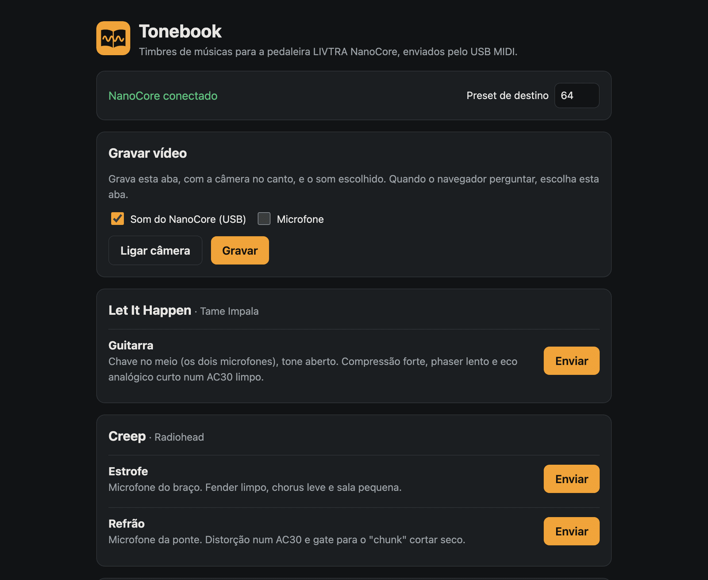
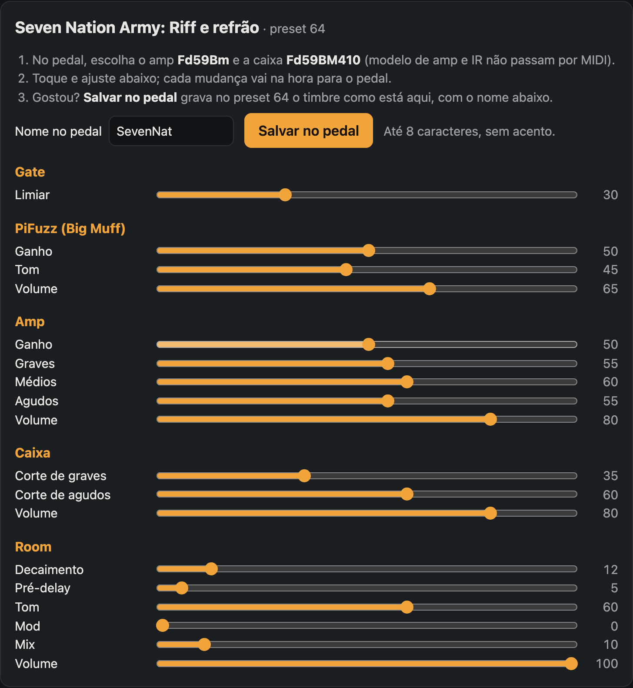
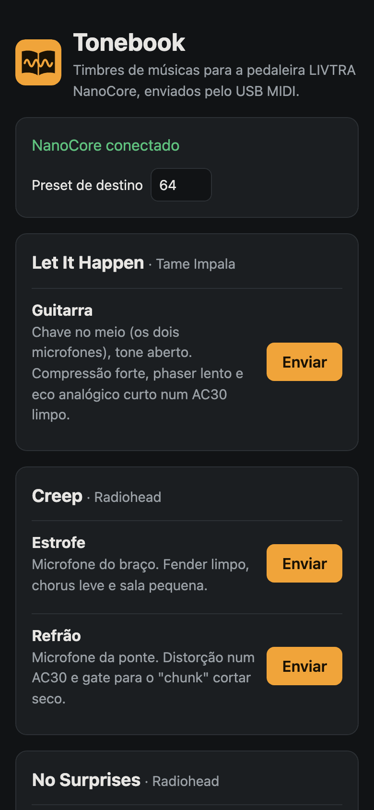
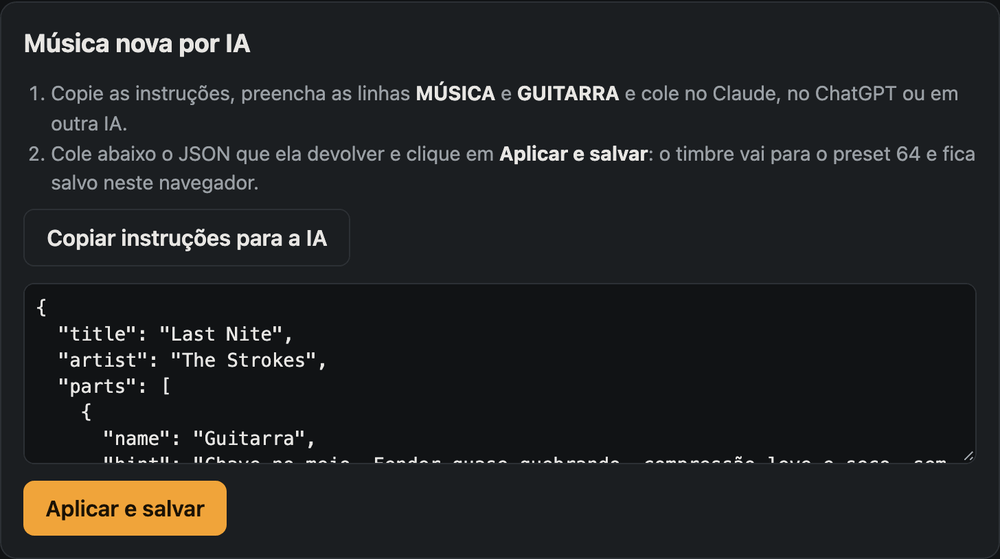

<p align="center"></p>

<h1 align="center">Tonebook</h1>

<p align="center">Timbres de músicas para a pedaleira <strong>LIVTRA NanoCore</strong>, enviados pelo navegador via USB MIDI.<br>
<a href="https://patogordo.github.io/Tonebook/">patogordo.github.io/Tonebook</a> · <a href="#english">English</a></p>

---

Você escolhe a música, o Tonebook leva um preset do pedal àquele timbre e deixa ajustar cada parâmetro ao vivo,
tocando. Gostou? Dá nome ao preset e salva no próprio pedal. Não achou a música? Uma IA monta o timbre a partir das
instruções do site, e ele confere, aplica e guarda.

> Projeto independente, sem relação com a LIVTRA. LIVTRA, NanoCore e ToneCommand são marcas dos seus donos. O site
> só manda ao pedal o que o guia oficial de MIDI documenta e, para dar nome e salvar o preset, os mesmos comandos que o
> app oficial usa. Nada é gravado na memória do pedal sem você clicar em **Salvar no pedal** e confirmar. Use por sua
> conta.

<p align="center">
  
</p>

## O que faz

- **Timbres prontos** de músicas conhecidas, pensados para guitarra com humbuckers, com a dica de microfone e técnica.
- **Ajuste ao vivo**: cada controle do site muda o pedal na hora.
- **Nome do preset e salvar no pedal**, com confirmação e só no preset que recebeu o timbre.
- **Música nova por IA**: copia instruções para Claude, ChatGPT ou outra IA, recebe um JSON, confere, aplica e salva
  no navegador.
- **Gravar vídeo** da aba com a câmera no canto e o som do pedal, do microfone ou dos dois.

Músicas incluídas: Let It Happen (Tame Impala), Creep e No Surprises (Radiohead), Jane! (The Long Faces), Come As You
Are (Nirvana), Seven Nation Army (The White Stripes), Pluto Projector (Rex Orange County), Impostor Syndrome (Sidney
Gish) e At Doom's Gate (Doom, 1993).

## Do que precisa

- Um LIVTRA NanoCore com firmware 1.04 ou mais novo, ligado por cabo USB (no Android, com adaptador OTG).
- Chrome, Edge ou Brave, no computador ou no Android. Safari e iPhone não têm Web MIDI.

## Como usar

1. Ligue o NanoCore no USB, abra o site e clique em **Conectar ao NanoCore**. Permita o acesso ao MIDI, inclusive
   "controlar e reprogramar dispositivos MIDI": é por ele que vai o nome do preset.
2. Escolha o preset de destino (padrão: 64) e clique em **Enviar** na parte da música.
3. No pedal, escolha o amp e a caixa indicados: o MIDI do NanoCore não troca o modelo de amp nem a IR.
4. Toque e ajuste nos controles.
5. O nome vai junto com o timbre (até 8 caracteres, sem acento); para trocar, edite **Nome no pedal** e clique em
   **Mudar nome**.
6. Gostou? **Salvar no pedal** grava o preset de destino, com o nome do campo, depois de confirmar. Trocar de preset
   antes disso descarta as mudanças, e o site recusa salvar se o pedal estiver em outro preset.

<p align="center">
  
  
</p>

### Música nova por IA

1. **Copiar instruções para a IA** copia o [`shared/prompt-ia.md`](shared/prompt-ia.md). Preencha as linhas `MÚSICA`,
   `GUITARRA` e, se quiser, `MODELOS CARREGADOS`, e cole no Claude, no ChatGPT ou em outra IA. As instruções trazem
   cada efeito com a ordem e a faixa real dos parâmetros, os modelos de amp e caixa e as regras de timbre de
   [`docs/timbres.md`](docs/timbres.md).
2. Cole a resposta no campo e clique em **Aplicar e salvar**. O site confere tipos, quantidade e faixa dos parâmetros
   e nomes de amp e caixa, e explica o que estiver errado. Texto ou bloco de código em volta do JSON não atrapalham.
3. A música vai para o preset de destino e fica salva no navegador, na lista, com **Remover**. Colar de novo uma
   música com o mesmo título e artista substitui a anterior.

<p align="center">
  
</p>

### Gravar vídeo

No computador (o navegador do celular não grava a tela):

1. **Ligar câmera**: ela aparece no canto da página; **Tamanho** vai de 160 a 720 px.
2. Marque o som: **Som do NanoCore (USB)**, **Microfone** ou os dois, que entram misturados e sem os filtros de voz do
   navegador (que estragam a guitarra).
3. **Gravar** e, quando o navegador perguntar, escolha **esta aba**.
4. **Parar** e **Baixar vídeo** (MP4; WebM nos navegadores que não gravam MP4).

## Limites

- Modelo de amp, IR da caixa, ordem da cadeia e volume do preset não passam por MIDI. Um preset vazio abre com volume
  100, mais alto que os de fábrica (por volta de 85).
- O nome do preset e o salvar vão pelo SysEx não documentado do app oficial; uma atualização de firmware pode mudar
  isso (o site avisa quando o pedal não confirma).
- Pitch e wahs do bloco de drive usam os mesmos controles da modulação.
- A faixa do Pitch muda com o firmware (±12 ou ±24 semitons).

Detalhes em [`docs/protocolo.md`](docs/protocolo.md).

## Desenvolvimento

```bash
git clone https://github.com/patogordo/Tonebook.git
cd Tonebook
corepack enable
pnpm install
pnpm dev          # http://localhost:3300
```

O site é estático (Nuxt 4 como SPA), sem servidor nem segredo, e vai para o GitHub Pages a cada push na `main`.

- [`docs/rodar-local.md`](docs/rodar-local.md): requisitos, testes, formatação e como ver o build de produção.
- [`docs/deploy.md`](docs/deploy.md): GitHub Pages, outras hospedagens estáticas e servidor próprio.

- [`docs/protocolo.md`](docs/protocolo.md): USB, MIDI oficial, o SysEx do app decifrado e o formato do backup.
- [`docs/timbres.md`](docs/timbres.md): como os timbres são pensados e medidos na saída do pedal.
- [`AGENTS.md`](AGENTS.md): estrutura do código, regras que não se quebram e convenções, para pessoas e agentes de
  código.
- [`tools/`](tools): sonda de MIDI (macOS) e decodificador do SysEx, para investigar o pedal.

## Contribuindo

Timbre novo, correção de timbre, música por IA que ficou boa, descoberta sobre o pedal: abra uma issue ou um pull
request. Para timbre, diga de onde veio (fonte da gravação ou ouvido) e com que guitarra testou. Para o protocolo,
siga a regra de segurança de [`docs/protocolo.md`](docs/protocolo.md): nada de mandar ao pedal comando que o app
oficial não manda.

## Licença

[MIT](LICENSE).

---

## English

**Tonebook** sets a preset on the **LIVTRA NanoCore** guitar multi-effects to the tone of a known song, straight from
the browser over USB MIDI (Chrome, Edge or Brave, desktop or Android). It lets you tweak every parameter live, name
and save the preset on the pedal, generate new song tones with any AI from a built-in prompt (the site
validates, applies and stores the JSON locally) and record a video of the page with your camera and the pedal's
sound.

It is an unofficial, independent project. It only sends what the official MIDI guide documents, plus the official
app's own SysEx commands to rename and save the active preset; nothing is written to the pedal's memory unless you
click **Salvar no pedal** and confirm.
The interface and docs are in Portuguese; [`docs/protocolo.md`](docs/protocolo.md) documents the NanoCore's USB
interfaces, MIDI map and the reverse-engineered SysEx framing (7-bit packing, request/response/notification layout,
observed commands).
